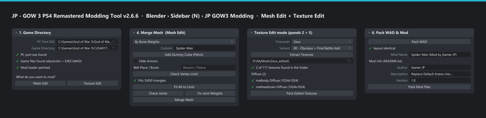

# JP - GOW 3 PS4 Remastered Modding Tool - Blender Add-on

**A free Blender add-on for modding *God of War III Remastered* (PC, gow3_pc port).**
**Mesh Edit:** put your own character into the game as Kratos (or replace his blades). **Texture Edit:** retexture any character, enemy, weapon or item – without touching its mesh. Everything from one sidebar in Blender.

> **v2.6.6.** Mesh Edit replaces **Kratos – Default Mesh** (`R_HERO00.WAD`) and the **Blades of Exile / Athena / Olympus**. Texture Edit works on **195 game files**: all Kratos outfits, gods, bosses, enemies, weapons and items.

> This is an early version I made for my own use. I'd love to share it with you so you can test it.
> — **Gamer JP**

[](https://www.youtube.com/@jpthehero)
[](https://www.patreon.com/c/gamerjp)
[](https://discord.gg/uBTutBA8VX)



---

## Contents

1. [Features](#features)
2. [Requirements](#requirements)
3. [Download and installation](#download-and-installation)
4. [Choose your mode: Mesh Edit or Texture Edit](#choose-your-mode-mesh-edit-or-texture-edit)
5. [Panel 1 – Game Directory](#panel-1--game-directory)
6. [Mesh Edit – Panel 2 – WAD Process](#mesh-edit--panel-2--wad-process)
7. [Mesh Edit – Panel 3 – Import Model](#mesh-edit--panel-3--import-model)
8. [Mesh Edit – Preparing your character](#mesh-edit--preparing-your-character)
9. [Mesh Edit – Panel 4 – Merge Mesh](#mesh-edit--panel-4--merge-mesh)
10. [Mesh Edit – Vertex limits and Fit to Limit](#mesh-edit--vertex-limits-and-fit-to-limit)
11. [Mesh Edit – Joints: Check, Fix and Test Bend](#mesh-edit--joints-check-fix-and-test-bend)
12. [Mesh Edit – Panel 5 – Texture Edit](#mesh-edit--panel-5--texture-edit)
13. [Mesh Edit – Weapons](#mesh-edit--weapons)
14. [Texture Edit – Retexture anything](#texture-edit--retexture-anything)
15. [Panel 6 – Pack WAD & Mod](#panel-6--pack-wad--mod)
16. [Testing in game, updating and removing a mod](#testing-in-game-updating-and-removing-a-mod)
17. [Files and folders](#files-and-folders)
18. [Messages and troubleshooting](#messages-and-troubleshooting)
19. [Known limits](#known-limits)
20. [Quick checklists](#quick-checklists)
21. [Credits](#credits) · [Disclaimer](#disclaimer) · [License](#license)

---

## Features

**Mesh Edit**
- **Real game skeleton** (`Kratos_GameSkeleton`, 52 bones on Kratos's real joints) plus Kratos's body, armour and face parts with their game weights.
- **Check Vertex Limit** (UV seams counted like the game, red = doesn't fit) and **Fit to Limit** (reduces only what doesn't fit, on a copy).
- **By Bone Weights** or **By Body Region** (region vertex counts in tooltips), **Add Dummy Cube (Pelvis)** for low-poly characters.
- **Check / Fix Finger Order**, **Check Joints / Fix Joint Weights**, **Test Bend**.
- Keep or remove Kratos's pieces **one by one**: Belt Piece, Boots, Shin Plate, Boot Wings, Bracers, Fleece, Skirt, Hermes Boots, Eyes, Beard, Mouth.
- **Kratos-style culling** – limbs don't vanish in cutscene close-ups.
- **Weapons**: Blades of Exile (all 5 levels), Blades of Athena, Blade of Olympus – with a **Glow** picker.
- Textures: one set for everything or one per game texture, dummy normal / specular / occlusion maps, DXT with mipmaps.

**Texture Edit**
- **195 files**: Kratos (9 outfits + Fear / Soul), Zeus, Hades, Athena, Poseidon, Hercules, Hermes, Hera, Helios, Aphrodite, Pandora, enemies with their Soul versions, all weapons and items.
- Edit the extracted PNGs, keep their names, pick **one folder** – only the textures found there are packed, exactly as painted.

**Both**
- **Pack WAD** checks the file the way the game reads it; **Pack Mod Files** writes a ready mod folder (`<Mod Name> vN`).
- **Mod info**: Author, Description, Version → every mod's `README.txt`.
- **Change outfit name** in the costume menu (all 16 languages).
- Runs entirely inside Blender – **no extra tools or installs**.

## Requirements

| Item | Details |
|---|---|
| Blender | **4.2 or newer** |
| Game files | Your own extracted PS4 game folder, **CUSA01715** (tested on v1.02), with `eboot.bin` and `EXEC\WAD\PS4_LE` |
| gow3_pc port | The folder with `God of War III.exe` – it holds the `mods` folder and the work folder `JPGow3 Temp` |
| Mesh Edit | A mesh with a UV map and textures, to be rigged to the game skeleton |
| Texture Edit | Any image editor that saves PNG with alpha |
| OS | Windows 10 / 11 |

You need **your own copy of the game**. This add-on contains **no game files**.

## Download and installation

1. Download **`JP_GoW3_Modding_Master_v2.6.6.zip`** from the [**Releases**](../../releases) page – **do not unzip it**.
   Older versions (e.g. [v1.7.2](../../releases/tag/v1.7.2)) stay available on the Releases page.
2. Remove an older version: **Edit → Preferences → Add-ons**, find *JP GOW3 Modding* / *JP - GOW 3 PS4 Remastered Modding Tool*, remove it, **restart Blender**.
3. **Edit → Preferences → Add-ons →** drop-down arrow (top right) **→ Install from Disk…** → pick the zip → tick **JP - GOW 3 PS4 Remastered Modding Tool - Blender Add-on**.
4. Restart Blender. In the 3D View press **N** → tab **JP GOW3 Modding**.

| Panel | Used for |
|---|---|
| 1. Game Directory | Paths, mod loader status, **Mesh Edit / Texture Edit** switch |
| 2. WAD Process | Choose what to mod and extract it |
| 3. Import Model | Mesh Edit: skeleton + Kratos's meshes · Texture Edit: preview of Kratos Default |
| 4. Merge Mesh | Mesh Edit only: check, fit and merge your model |
| 5. Texture Edit | Pack your textures |
| 6. Pack WAD & Mod | Check the WAD, mod info, write the mod folder |
| About / Credits | Tool name, version, author links |

## Choose your mode: Mesh Edit or Texture Edit

| | Mesh Edit | Texture Edit |
|---|---|---|
| What changes | Mesh + textures (your own model) | Only textures – the game's mesh stays |
| What you can mod | Kratos Default, Blades of Exile / Athena / Olympus | 195 files: every character, enemy, weapon, item |
| Panels used | 1 → 2 → 3 → 4 → 5 → 6 | 1 → 2 → 5 → 6 (3 = preview) |
| Limits | Kratos's vertex / triangle budget | None (texture sizes stay the game's) |
| Skill needed | Rigging, weight painting | Painting on the extracted PNGs |

> **Tip:** switching modes never deletes your work. In Texture Edit, **Pack WAD** always writes the game's **original mesh**, even if you merged a mesh earlier.

## Panel 1 – Game Directory

| Option | What it does |
|---|---|
| **INI** / **Load INI** / **Save INI** | Settings file (empty = next to the add-on): the paths and your author name. Read automatically when Blender starts. |
| **PC Port EXE** | `God of War III.exe` of the gow3_pc port |
| **Game Directory** | The folder with `eboot.bin` and `EXEC` – both lines must show a green tick |
| **Mod loader** | Current port versions load God of War III mods by themselves (*Mod loader patched*). Only old ports show **Fix Mod Loader** – better: update the port. |
| **What do you want to mod?** | **Mesh Edit** or **Texture Edit** |

## Mesh Edit – Panel 2 – WAD Process

- **Characters / Weapons** – replace Kratos or one of his blades ([Weapons](#mesh-edit--weapons)).
- **Character / Outfit** – Kratos – Default Mesh (`R_HERO00.WAD`).
- **Extract WAD + Textures** – copies the WAD into `JPGow3 Temp` (original + work copy) and exports its textures as PNG.

> **Important:** extracting again resets the work WAD (merged / packed state). Your Blender scene stays.

## Mesh Edit – Panel 3 – Import Model

**Import Model** builds `Kratos_GameSkeleton` (52 bones on Kratos's **real game joints**) and Kratos's parts with their game weights:

| Collection | Contents |
|---|---|
| `GoW3_Skeleton` › `Kratos_GameSkeleton` | Bones like `j067 arm right elbow` – number = game joint |
| `…_Body` | Kratos's skin parts – the slots your character goes into |
| `…_Armor` | Skirt, boots, shin plate, bracers, fleece, belt piece, Hermes boots |
| `…_FaceExtras` | Eyes, beard, teeth, tongue, eyelid piece |

> **Important:** never move the skeleton's bones. A scene from a version before 2.3 shows **Update Skeleton** – it moves the old skeleton onto the real joints (meshes keep their shape and weights).

## Mesh Edit – Preparing your character

| Rule | Why |
|---|---|
| Own collection (e.g. `Custom`), Armature modifier to `Kratos_GameSkeleton` | Panel 4 takes that collection; poses test like the game |
| Vertex groups named exactly like the bones (`j135 leg right thigh`), only `j` bones | Other groups are ignored |
| Match Kratos's size and pose; paint the bends right at the joints | The game always bends at its joints |
| Apply transforms, UV map on every mesh, no shape keys before Fit | Positions are read in world space |
| Max 4 bones per vertex (weights under 0.1 are dropped) | The game stores 4 per vertex |
| One material / one texture set for the whole character | Several materials end up on the wrong parts |
| Close or Solidify thin single-sided parts (visors, capes, plates) | One-sided faces vanish from behind |

| Area | Bones |
|---|---|
| Hips / spine / head | `j002 root hips`, `j003 spine 1`, `j004 spine 3`, `j005` / `j006 head neck`, `j008 head jaw` |
| Arms | `j065` / `j066 arm right shoulder 1/2`, `j067 elbow`, `j068 wrist` (left: `j102`–`j105`) |
| Fingers | thumb = 1, index = 2, middle = 3, ring = 4, little = 5; joints a, b, c – e.g. `j069 arm right finger 2a` |
| Legs | `j135 thigh`, `j136 knee`, `j137 ankle`, `j138 toe` (left: `j149`–`j152`) |

Weights on `j002 root hips` below the waist become the game's pelvis on Merge; upper-arm weights are spread over Kratos's twist joints automatically.

## Mesh Edit – Panel 4 – Merge Mesh

| Option | What it does |
|---|---|
| **Placement** | **By Bone Weights** (one collection) or **By Body Region** (one mesh per region – hover the ⓘ next to Head / Body / Legs / Arms for its game vertex count and limit) |
| **Add Dummy Cube (Pelvis)** | A 4 mm cube on the pelvis, added to your collection (and to an empty Legs & Hips slot) – for low-poly characters without separate legs |
| **Hide Armors** | Ticked: all armour removed. Unticked: a checkbox per piece – Belt Piece, Boots, Shin Plate, Boot Wings, Bracers, Fleece, Skirt, Hermes Boots – ticked pieces stay |
| **Hide Eyes, Beard, Mouth** | The same for Eyes, Beard, Mouth |
| **Slots** | Optional per mesh: Auto (by weights) or one Kratos slot |
| **Check Vertex Limit** | Does it fit? Paints what doesn't fit red |
| **Fit All to Limit** | Reduces a copy until it fits ([Vertex limits](#mesh-edit--vertex-limits-and-fit-to-limit)) |
| **Check / Fix Finger Order** | Fixes swapped finger groups |
| **Check Joints / Fix Joint Weights / Test Bend** | [Joints](#mesh-edit--joints-check-fix-and-test-bend) |
| **Kratos-style culling** | Tight culling spheres (default on) – limbs don't vanish in close-ups |
| **Merge Mesh** | Writes your character into the work WAD |

Kept pieces take the edits you made to the imported piece in Blender – as long as its **vertex count stays the same**.

## Mesh Edit – Vertex limits and Fit to Limit

Each Kratos slot has a fixed number of vertices **and** triangles. **Game vertices** count every UV seam twice; **triangles** count a quad as 2 and an n-gon as n − 2 (Blender: Viewport Overlays → Statistics → *Triangles*).

| Slot | Max vertices | Max triangles |
|---|---:|---:|
| Foot R / Foot L | 730 / 729 | 1,056 / 1,056 |
| Forearm R / Forearm L | 858 / 862 | 1,276 / 1,276 |
| ShoulderPiece / ShoulderPiece L | 236 / 207 | 384 / 336 |
| Head | 1,495 | 1,968 |
| Pelvis Thighs | 1,267 | 1,786 |
| Toes R / Toes L | 57 / 57 | 66 / 66 |
| Chest Back UpperArms | 1,647 | 2,563 |
| Hand R / Hand L | 864 / 847 | 1,174 / 1,174 |
| Face detail ×8 | 1,736 | 2,137 |
| **Total** | **11,592** | **16,318** |

- **Fit All to Limit** (or **Fit Head to Limit** … in region mode) decimates a **copy**, only where bones ran out of room, and checks again until it fits. Your originals are hidden, never changed.
- It never takes a mesh below 70% in one run and stops when it can't improve – run it again or reduce heavy areas yourself (Decimate, inner faces, fewer UV seams).
- A few triangles whose bone mix fits no slot go to the nearest slot instead of blocking Merge.
- Remove shape keys first.

## Mesh Edit – Joints: Check, Fix and Test Bend

- **Check Joints** – finds where your weights bend at the hips, knees, ankles, shoulders, elbows and wrists and compares it with Kratos's real game joints.
- **Fix Joint Weights** – moves each bend onto the game joint (on the `_fit` copies).
- **Test Bend** – bends the skeleton so you see in Blender how the character bends in game; click again to reset.

> **Tip:** torn knees or elbows in game = the bend in the weights is far from the joint: Check Joints → Fix Joint Weights → Test Bend → Merge.

## Mesh Edit – Panel 5 – Texture Edit

| Option | What it does |
|---|---|
| **Same textures for all meshes** | One image per kind for every Kratos texture (untick for one per game texture) |
| **Diffuse** | Your colour map (always needed) |
| **Dummy Normal / Specular / Occlusion** | On (default) = flat normal, low shine, no occlusion; untick to use your own maps |
| **Flip Normal Green (DirectX)** | For DirectX-style normal maps |
| **Pack Textures** | DXT with all mipmaps into the work WAD |

Blood overlays are switched off automatically (they follow Kratos's body layout). Normal maps already in the game's orange layout are packed as they are. With armour kept, shared images fill only the Body / Head textures.

## Mesh Edit – Weapons

1. Panel 2: **Weapons** → **Blades of Exile** (all 5 upgrade levels at once), **Blades of Athena** or **Blade of Olympus** → **Extract WAD + Textures**.
2. **Import Model** – the game blade appears where it sits in the game.
3. Model your weapon in the same place, size and direction: **one mesh with UVs** (no rigging – blades are rigid).
4. Panel 4: pick it as **Weapon Mesh** → **Check Vertex Limit** → **Merge Mesh**.
5. Panel 5: Diffuse, maps and **Glow** (black = no glow, colour = glows in that colour; empty = no glow). The Blades of Athena also have an **Extra Layer** (empty = the Diffuse).
6. Panel 6 as usual – every file of that weapon is written.

## Texture Edit – Retexture anything

1. Panel 1: **Texture Edit**.
2. Panel 2: pick a **Character** and a **Variant** → **Extract Textures** → **Open Extracted Textures (PNG)**.
3. Edit the PNGs you want **without renaming them** and save them in **one folder** (any place).
4. Panel 5: pick that folder. Only the textures found there are listed (ticked, by kind): *"2 of 117 textures found in the folder"*.
5. **Pack Edited Textures** → panel 6: **Pack WAD** → **Pack Mod Files**.

| Character list | Variants |
|---|---|
| Kratos | Default, Fear Kratos, Apollo, Morpheus Armor, Phantom of Chaos, Forgotten Warrior, Dominus, Deimos, HERO08, Fear / Soul versions |
| Gods and bosses | Zeus 00–60, Hades (+ Big / Soul / Flesh), Athena, Poseidon, Hercules, Hermes, Hera, Helios, Hephaestus, Aphrodite, Persephone, Pandora, Daedalus … |
| Enemies | Cyclops, Centaur, Minotaur, Harpy, Cerberus, Chimera, Medusa, Siren, Satyr, Wraith, Grunt, Archer … + their **Soul** versions |
| Weapons and items | Blades of Exile / Athena, Claws of Hades, Nemesis Whip, Nemean Cestus, Blade of Olympus, Item Fire / Ice / Light – each with **All files (every upgrade level)** |

**How files are matched**
- Each extracted PNG is named like `matbody_Diffuse__TXA0A1CB5B….png`. Your edit is found by the **`TX…` code** – keep that part of the name.
- Only matched textures are packed, **exactly as painted** (alpha included; another size is resized). Everything else stays the game's – remove a file from the folder to get the original back.
- Normal maps are the orange game layout; blood masks are dark red with the shape in the alpha – edit them as they are.
- Cube maps and rare formats are listed as **Can't be edited (cube map / other format)**.
- **Import Model** is a preview for Kratos Default (extract it once in Mesh Edit).
- Kratos's outfits: panel 6 also offers **Change outfit name**.

## Panel 6 – Pack WAD & Mod

| Option | What it does |
|---|---|
| **Pack WAD** | Checks the WAD like the game and writes it to `JPGow3 Temp\…\output`. Texture Edit: the game files + your textures, nothing else |
| **Change outfit name** | Your name in the costume menu (all 16 languages; Kratos outfits) |
| **Mod Name** | Folder name |
| **Mod info** | **Author** (remembered by Save INI), **Description** (empty = written automatically), **Version** |
| **Add version (vN)** | Never overwrite an older build |
| **Pack Mod Files** / **Open Mods Folder** | Writes the mod into the port's `mods` folder |

Every mod gets a `README.txt`:

```
Mod Name : Spider-Man (Mod by Gamer JP)
Game : GOW III Remastered PS4 PC Port
Author : Gamer JP (https://www.youtube.com/@jpthehero)
Description : Replace Default Kratos into Spider-Man
Version : 1.0

Replaces : R_HERO00.WAD (Kratos / Default Mesh)
Install : put this folder in the port's 'mods' folder and untick other mods that replace R_HERO00.WAD.
Made with : JP - GOW 3 PS4 Remastered Modding Tool v2.6.6 by Gamer JP (https://www.youtube.com/@jpthehero)
```

## Testing in game, updating and removing a mod

1. Enable the mod in the port's mod list; untick other mods that replace the same WAD files.
2. Start the game and test: walking, combat, climbing, a cutscene, the pause menu.

- **Updating:** change your model or textures → Merge (Mesh Edit) or Pack Edited Textures (Texture Edit) → Pack WAD → Pack Mod Files. With *Add version* on you get v2, v3 … – enable the newest.
- **Removing:** untick it in the port, or delete its folder. The game files are never changed.
- A dark band on the lower legs of big-footed characters in gameplay (gone in pause / photo mode) is the game's own foot-shadow effect, not your mod.

## Files and folders

| Path (next to the port exe) | Contents |
|---|---|
| `JPGow3 Temp\Kratos_DefaultMesh\` | Mesh Edit work: original / work / output WAD, textures, `merge_report.json`, `state.json` |
| `JPGow3 Temp\Weapon_…\` | Weapon work folders |
| `JPGow3 Temp\Texture Edit\<file>\` | Texture Edit work: textures (PNG), original, work, output |
| `mods\<Mod Name vN>\` | The finished mod + `README.txt` |
| `JP_GoW3_Modding.ini` (add-on folder) | Paths and author |

## Messages and troubleshooting

| Message / problem | Fix |
|---|---|
| *Set the PC Port EXE and Game Directory first* | Panel 1 – both green ticks |
| *Vertex limit is more: …* | **Fit All to Limit** or reduce the named area (red faces) |
| Same vertex count but too many triangles | Quads = 2 triangles, n-gons = n − 2: check *Statistics → Triangles*; decimate or Fit |
| *Kratos_GameSkeleton was edited … re-import it* | Delete it and **Import Model** again (old scene: **Update Skeleton**) |
| *'…' has shape keys - remove them first* | Remove or apply the shape keys |
| *Pick the folder with your edited textures* | Texture Edit: pick the folder; keep the `TX…` names |
| *No file with a 'TX...' name in that folder* | Renamed files – restore the extracted names |
| *Work WAD layout changed - Extract again* | Extract again |
| *Merge the mesh first* / *Pack the WAD first* | Do the steps in order |
| Torn knees / elbows | Check Joints → Fix Joint Weights → Test Bend → Merge |
| Limbs vanish in cutscenes | Keep **Kratos-style culling** on |
| Lines / blotches on the skin | Dummy Normal / Specular on (Mesh Edit) |
| Fingers bend across each other | **Check / Fix Finger Order**, Merge again |
| Mod not shown in game | Mod enabled? Other mods for the same WAD unticked? Port up to date? |

Details are printed in Blender's system console (*Window → Toggle System Console*, lines start with `[JP GoW3]`) – include them when you ask for help on [Discord](https://discord.gg/uBTutBA8VX).

## Known limits

- Mesh Edit: Kratos – Default Mesh and the three blade sets only. Other characters: Texture Edit.
- Mesh Edit uses Kratos's vertex budget (~11,600 vertices) – the mesh can't grow.
- Your character uses Kratos's bones and animations; hair or capes only move on existing bones (e.g. the skirt bones).
- Texture Edit can't change cube maps and a few rare formats; texture sizes stay the game's.
- Glow is only edited on weapons.

## Quick checklists

**Mesh Edit**
- [ ] Mode: Mesh Edit; paths OK
- [ ] Extract → Import Model
- [ ] Rig to `j` bones in your own collection; Test Bend looks right
- [ ] Check Vertex Limit → Fit → Finger Order → Check Joints
- [ ] Pieces / Dummy Cube as wanted → Merge
- [ ] Texture Edit: Diffuse (+ maps) → Pack Textures
- [ ] Pack WAD → Mod info → Pack Mod Files → test

**Texture Edit**
- [ ] Mode: Texture Edit; pick Character + Variant → Extract Textures
- [ ] Edit the PNGs, keep the names, save them in one folder
- [ ] Pick the folder → check the ticked list → Pack Edited Textures
- [ ] Pack WAD → Mod info → Pack Mod Files → test

## Credits

- **Gamer JP** – author ([YouTube](https://www.youtube.com/@jpthehero) · [Patreon](https://www.patreon.com/c/gamerjp) · [Discord](https://discord.gg/uBTutBA8VX))
- **gow3_pc** port and its authors – for making God of War III playable and moddable on PC
- Santa Monica Studio / Sony Interactive Entertainment – *God of War III*

Please credit **Gamer JP** when you share mods made with this add-on.

## Disclaimer

This is a fan-made tool, not affiliated with or endorsed by Sony Interactive Entertainment or Santa Monica Studio.
*God of War* is a trademark of Sony Interactive Entertainment LLC. The add-on contains no game data; use extracted assets for personal modding only.

## License

See [LICENSE.txt](LICENSE.txt). Free to use; you may share mods made with it (credit **Gamer JP**), but please don't re-upload, modify or sell the add-on itself.
